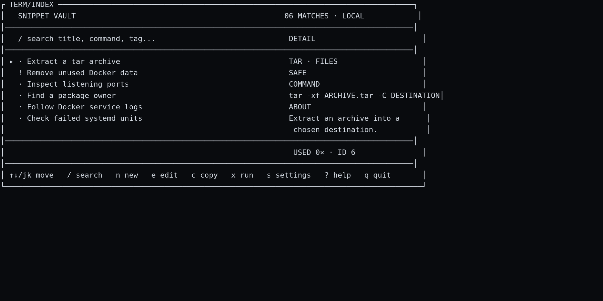
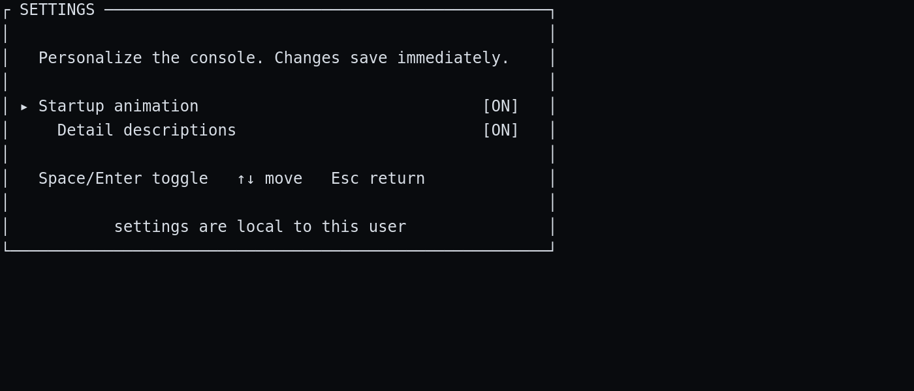

# termindex

`termindex` is a compact monochrome TUI for keeping a personal index of terminal snippets, especially commands learned while installing or configuring new tools.

## Preview





## Run

```bash
cd /home/scorn/termindex
./termindex
```

For a checkout you use regularly, make the launcher available as `termindex` from any directory:

```bash
ln -sfn "$PWD/termindex" ~/.local/bin/termindex
termindex
```

The launcher resolves the repository path automatically, so the symlink can live outside the checkout. Termindex has no third-party Python dependencies.

The database lives at `~/.local/share/termindex/snippets.db` by default. Use `--db PATH` to point it somewhere else.

## Keys

`j/k` or arrows move · `/` search · `n` new · `e` edit · `d` delete · `c` copy · `x` run · `v` onion identity · `s` settings · `?` help · `i` import · `o` export · `q` quit

Search and form fields support left/right, Home/End, Backspace, and Ctrl-U. Press Esc to cancel a prompt. The interface is designed for terminals at least 64 columns by 18 rows.

Settings are saved at `~/.config/termindex/settings.json`. The settings screen controls the short ASCII startup animation and whether descriptions appear in the detail pane. Run confirmations stay enabled, including the extra warning for dangerous commands.

Commands are never run without a confirmation dialog. Snippets marked `dangerous` get a second warning.

Press `v` to generate a Tor v3 onion identity. Enter an optional short vanity prefix of up to two characters using only `a-z` and `2-7`, or leave it blank for a random identity. The animated search can be cancelled with Esc. After confirmation, Termindex writes Tor-compatible `hostname`, `hs_ed25519_public_key`, and `hs_ed25519_secret_key` files with restrictive permissions. The private key is never shown or stored in the snippet database. OpenSSL is required for this feature; longer vanity searches are better served by a dedicated native generator.

For maintenance or scripting:

```bash
./termindex --check
./termindex --export ~/termindex-backup.json
./termindex --import ~/termindex-backup.json
./termindex --db /path/to/another.db
```

## Design

- SQLite-backed, local-first storage
- JSON import/export for backups and portability
- `wl-copy`, `xclip`, or `xsel` clipboard support when installed
- Tor v3 onion identity generation with optional vanity prefixes
- seeded with a small set of practical examples on first launch


