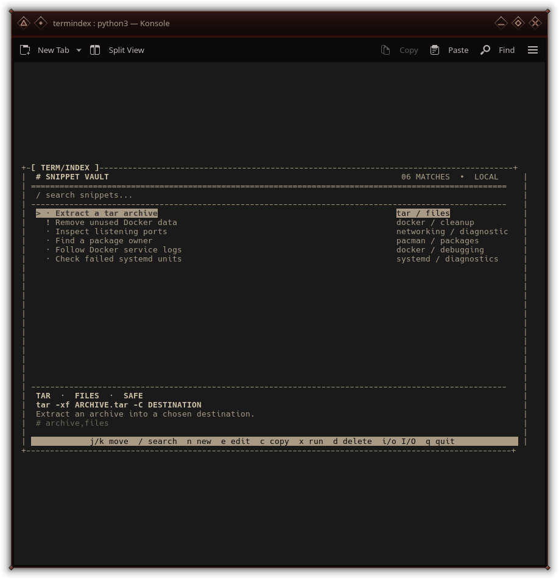

# termindex

`termindex` is a compact monochrome TUI for keeping a personal index of terminal snippets, especially commands learned while installing or configuring new tools.

## Preview



## Run

```bash
cd /home/scorn/termindex
./termindex
```

The database lives at `~/.local/share/termindex/snippets.db` by default. Use `--db PATH` to point it somewhere else.

## Keys

`j/k` or arrows move · `/` search · `n` new · `e` edit · `d` delete · `c` copy · `x` run · `i` import · `o` export · `q` quit

Commands are never run without a confirmation dialog. Snippets marked `dangerous` get a second warning.

For maintenance or scripting:

```bash
./termindex --check
./termindex --export ~/termindex-backup.json
./termindex --import ~/termindex-backup.json
./termindex --db /path/to/another.db
```

## Design

- SQLite-backed, local-first storage
- no third-party Python dependencies
- JSON import/export for backups and portability
- `wl-copy`, `xclip`, or `xsel` clipboard support when installed
- seeded with a small set of practical examples on first launch


